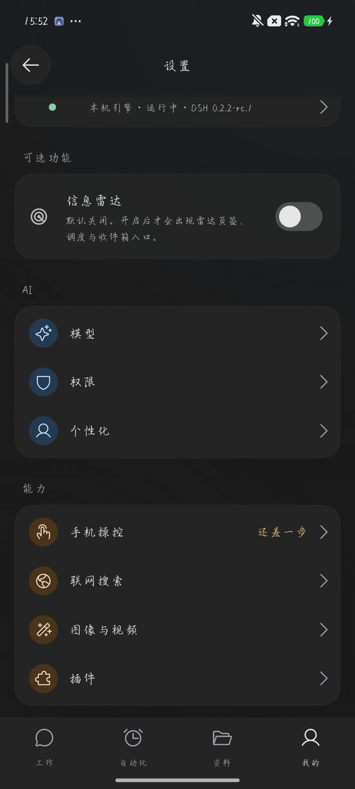
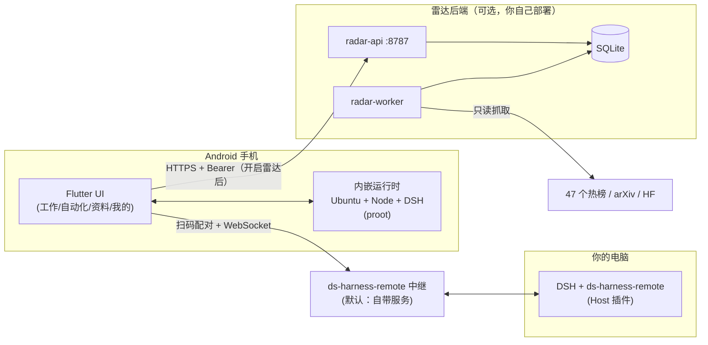
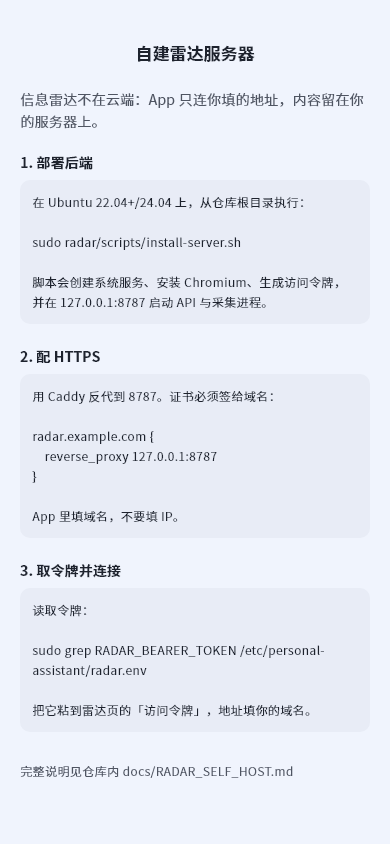

# DSH Buddy

把 [DeepSeek Harness](https://github.com/deepseek-ai) 装进 Android 手机：手机本身是一台 Agent 主机；
电脑上跑 `ds-harness-remote`，用手机扫码就能接上。**信息雷达是可选功能，默认关闭**。

- 下载即用：从 [Releases](https://github.com/ccch1mneyyy/dsh-buddy/releases/latest) 取 `app-arm64-release.apk`，安装到 arm64 Android 8.0+ 手机。
- 不预置任何**雷达**服务器：雷达没有默认地址；中继默认用 `ds-harness-remote` 自带服务，也可以在构建时换成你自己的。
- 仓库里没有作者的任何服务器、账号、令牌、路径或截图数据。



## 提供什么

| 能力 | 默认 | 说明 |
|---|---|---|
| **工作** | 开 | 与 DSH 的会话：流式输出、插话/停止、工具审批、工作区、技能/连接器/模型、专家预设、任务产物 |
| **扫码连接电脑** | 开 | 电脑端装好 DSH 与 `ds-harness-remote` 插件，手机扫码配对，之后可远程开会话 |
| **自动化** | 开 | 主机任务、运行记录、智能体团队、专家配置（雷达关闭时，雷达相关三项不出现） |
| **资料 / 我的** | 开 | 产物上传下载、设备与连接、外观、账号 |
| **信息雷达** | **关** | 47 个站点热榜、跨源共识、论文推荐、个人简报；需要一个你自己部署的服务器（仓库内提供安装脚本） |

关闭雷达时：底部没有雷达页签，自动化里没有服务/运行/收件箱，设置里没有雷达连接与自动刷新，
后台也不会轮询任何雷达接口。开启后才会出现这些入口，并在雷达页给出自建服务器教程。

## 五分钟上手

1. **装 App**：下载 Releases 里的 APK，`adb install -r app-arm64-release.apk` 或在手机上点开安装。
2. **配电脑**：装好 DSH 与 `ds-harness-remote` 插件，打开 **Remote settings → Sign in → `DSH Go pairing`**
   → Generate pairing QR code。**二维码只在「这台电脑还没登录 Remote」时出现**；已登录的主机请先
   Sign out（会断开现有远程连接），或直接在手机端用同一账号登录、不用扫码。
   中继保持默认（`ds-harness-remote` 自带服务）；要用自己的中继，见[构建](#从源码构建)。
3. **扫码**：手机「我的 → 主机 → 远程主机 → 扫码配对电脑」，扫电脑上的码，确认主机指纹，
   再把手机显示的 8 位码敲回电脑。配对不要求手机先登录 DeepSeek；登录后会把账号 ID 一并绑定。
4. **(可选) 开雷达**：设置 → 可选功能 → 信息雷达。开启后按雷达页的「自建服务器」教程部署后端，
   把地址与令牌填进去。

更细的步骤与排错见 [docs/QUICKSTART.md](docs/QUICKSTART.md)。

## 架构



- 中继只搬运加密帧，不落业务数据；手机与电脑之间是 `Noise_IK_25519_ChaChaPoly_SHA256`。
- 雷达与中继互不依赖：不用雷达也能扫码连电脑；不用远程也能单独跑雷达。
- 雷达只监听回环地址，公网由 Caddy/Nginx 终结 TLS。

## 信息雷达（可选）

**默认关闭。** 在「设置 → 可选功能」里打开后：

1. 雷达页出现连接卡片，点「没有服务器？看自建教程」按三步部署；
2. 或者直接在服务器上执行仓库内的脚本：

```bash
sudo radar/scripts/install-server.sh          # Ubuntu 22.04+/24.04，Python 3.11+
sudo grep RADAR_BEARER_TOKEN /etc/personal-assistant/radar.env
```

3. 用 Caddy 把 `127.0.0.1:8787` 反代成 HTTPS（证书签给域名），再把域名与令牌填进 App。



完整步骤、平台登录、常见问题见 [docs/RADAR_SELF_HOST.md](docs/RADAR_SELF_HOST.md)。

雷达是**只读**的：不发帖、不点赞、不关注、不改资料；请求按 `limits` 控频，不绕过风控。

## 从源码构建

| 用途 | 要求 |
|---|---|
| App | Flutter 3.47+ / Dart 3.13+、JDK 17、Android SDK（NDK 由 Flutter 决定） |
| 运行时资产 | x86_64 Linux（WSL2 可用）、`curl`/`xz`/`python3`、约 3 GB 磁盘 |
| 雷达后端 | Python ≥ 3.11、能装 Chromium 的 Linux |

```bash
# 1) 运行时（约 200 MB，不入库）
runtime/build-runtime.sh arm64-v8a

# 2) APK
cd app && flutter pub get
flutter build apk --release --flavor arm64 \
  --dart-define=RELAY_SERVER_HOST=relay.example.com   # 可省略：默认用自带中继
```

可选注入（不注入时 App 不预填任何地址）：

| 键 | 用途 |
|---|---|
| `RELAY_SERVER_HOST` | 自建中继域名 |
| `RADAR_SERVER_HOST` / `RADAR_SERVER_IP` | 自建雷达的域名与其 A 记录（用户粘裸 IP 时归一到域名） |

Windows 上可用 `tool/build-android.ps1 -RelayServerHost relay.example.com`，脚本会先跑分析与测试。
发布 APK 的签名与 Release 流程见 [docs/RELEASE.md](docs/RELEASE.md)。

## 目录

| 目录 | 内容 |
|---|---|
| `app/` | Flutter 客户端（Android） |
| `packages/dsh_client` | DSH 的 Dart RPC / 事件客户端 |
| `packages/dsh_remote` | `ds-harness-remote` 客户端：中继、配对、Noise 加密 |
| `runtime/` | 内嵌运行时构建与补丁层（Ubuntu base + Node + DSH，版本由 `patches/pins.json` 固定） |
| `radar/` | 可选的信息雷达后端（采集、热榜、简报、论文、API、部署脚本） |
| `tool/` | 打包、i18n、图标、校验脚本 |
| `docs/` | 快速开始、雷达自托管、发布说明、设计文档 |

## 隐私与安全

- **不预置服务器**：雷达没有默认地址；中继默认用公开的自带服务，可用 `RELAY_SERVER_HOST` 覆盖。
- **凭据留在本机**：雷达令牌写系统安全存储（另有一份明文副本对抗国产 ROM 的 Keystore 失效，断开时一起清除）；
  中继登录令牌同样由安全存储保管。
- **扫码配对**：只接受 `https://…/pair#v1.…` 形式的票，不打开网页、不跟随重定向、不记录验证码。
- **不提交**：`radar/secrets/`、`radar/browser_profiles/`、`radar/config.yaml`、`*.db`、`runtime/out/`、
  `tool/test-fonts/`、`android/key.properties`、`*.jks` —— `.gitignore` 已覆盖。

## 已知限制

- **运行时资产不入库**：先按上面第 1 步构建，否则 APK 打得出来但装上去起不来。
- **中继服务端不在本仓库**：`packages/dsh_remote` 是客户端；默认用上游自带服务，自建需部署
  [ds-harness-remote](https://github.com/liguobao/ds-harness-remote) 的 server。
- **雷达需要自己的服务器**：没有「公共雷达」可用；`X / 知乎 / 小红书` 采集通常需要登录态。
- **没有模型 Key 时**：雷达简报的摘要取原文片段，概览用规则聚合；配 `RADAR_MODEL_API_KEY` 后才有 AI 摘要。
- **金图测试需要字体**：`tool/test-fonts/`（55 MB）不入库，缺失时 `test/radar` 的 golden 会失败。

## 开发与测试

```bash
# 后端（可选组件）
cd radar && pip install -e ".[dev]"
python -m pytest -q && ruff check . && ruff format --check . && mypy src/

# App
cd app && dart analyze
flutter test test/radar          # 含「雷达开关」与金图
flutter test test/remote/pairing_test.dart
```

CI 只跑后端（`.github/workflows/backend.yml`）；App 的金图依赖字体与真实渲染，留给本地。

## 许可

**AGPL-3.0**，见 [LICENSE](LICENSE)。仓库包含基于 [dsh-Go](https://github.com/ccch1mneyyy/dsh-Go) 修改的客户端代码，
以及对 [ds-harness-remote](https://github.com/liguobao/ds-harness-remote)（MIT）的 Dart 客户端实现。

对外分发 APK（应用商店、下载链接）时，需要按 AGPL-3.0 提供对应源码。
品牌与吉祥物素材不在 AGPL 授权范围内，见 [ASSETS.md](ASSETS.md)；第三方组件见 [THIRD_PARTY_NOTICES.md](THIRD_PARTY_NOTICES.md)。

## 免责声明

本项目用于个人学习与自用。雷达只采集公开信息、只读、控频；请自行遵守目标站点的服务条款，
不要用于商业采集、批量分发或绕过访问控制的行为。

---

## English

DSH Buddy puts an on-device DeepSeek Harness runtime behind a Flutter Android app, and connects to a
desktop host by scanning a QR code from the `ds-harness-remote` plugin (the built-in relay is the
default; override it with `--dart-define=RELAY_SERVER_HOST=…`).

The **information radar is optional and off by default**: no tab, no automation entries, no polling
until you enable it in Settings. When enabled, it needs a server you host yourself — the repository
ships `radar/scripts/install-server.sh` and a step-by-step guide.

Runtime assets (~200 MB) are not in git: build them with `runtime/build-runtime.sh arm64-v8a` before
building the APK. Licensed AGPL-3.0; redistributing the APK requires publishing the source.
