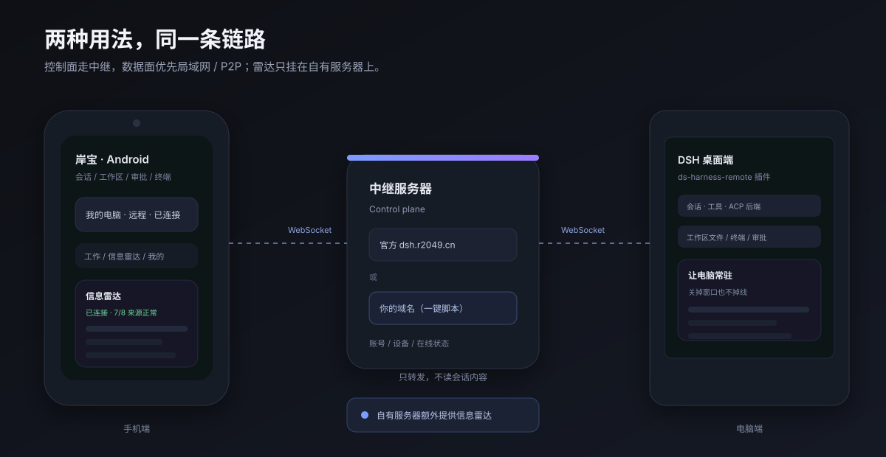
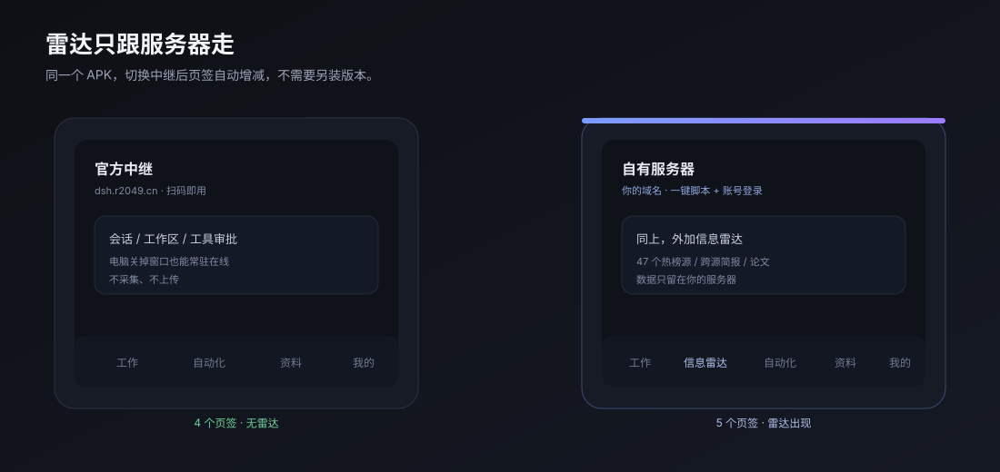
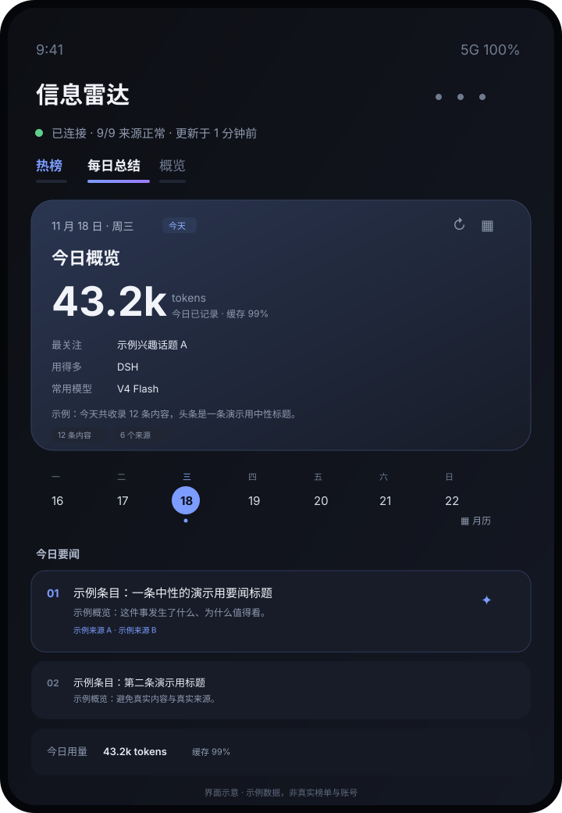
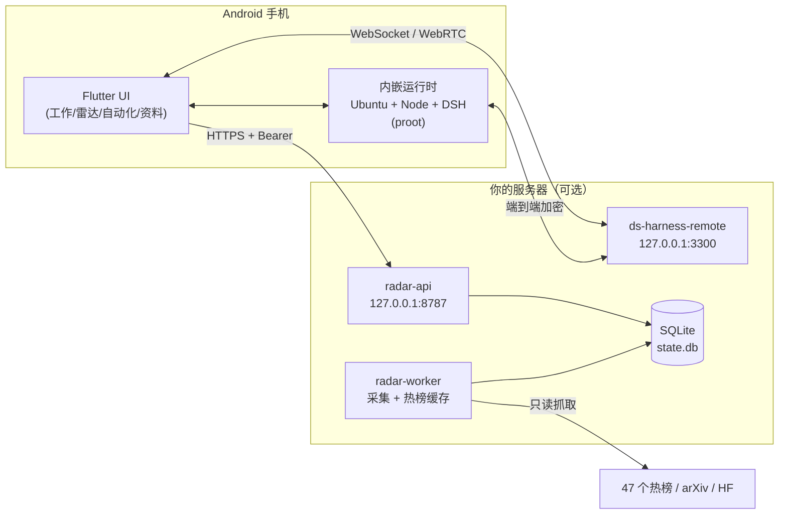

# DSH Buddy

> **一句话**：把电脑上的 DSH 装进手机。扫码走官方中继，或用自己的服务器当中继并解锁信息雷达。

**30 秒了解**

- 手机是 DSH 的原生客户端：会话、工作区、工具审批、模型切换、终端都能在手机上完成。
- **官方中继**：不用部署，扫码配对电脑；关掉 DSH 窗口后，「让电脑常驻」会让插件继续在线。
- **自有服务器**：一条命令装好中继 + 雷达 + HTTPS；雷达含 47 个热榜源、每日总结、跨源共识、论文推荐。
- 雷达只在自有服务器模式出现；官方中继下整套入口隐藏，不采集、不上传。

雷达不经过任何第三方：采集只读、数据留在你的服务器上；连官方中继时整套雷达界面
（页签、自动化入口、后台轮询、通知）都不会出现。

[](https://github.com/XXTZ-fia/dsh-buddy/actions/workflows/backend.yml)

## 界面

架构：手机通过中继连电脑，数据面优先局域网 / P2P；雷达只挂在自有服务器上。



同一个 APK，切换中继后页签自动增减：



信息雷达（界面示意，示例数据；仓库内所有界面图均为 SVG 示意图，不含真实账号、主机名或榜单）：



## 两种用法

| | 官方中继 | 自有服务器 |
|---|---|---|
| 服务器 | 无需部署，`dsh.r2049.cn` | 一台 Ubuntu 22.04+/24.04 + 两个域名 |
| 电脑 | 安装 dsh 与 `ds-harness-remote` 插件 | 同左，登录到你的中继 |
| 手机 | 扫码配对 | 「我的 → 连接 → 自建服务器」填地址与邮箱密码 |
| 信息雷达 | **隐藏** | **显示**，用脚本打印的令牌连接 |

## 快速开始

完整步骤与排错见 [docs/QUICKSTART.md](docs/QUICKSTART.md)。

### 官方中继

1. 电脑安装 dsh 与 [`ds-harness-remote`](https://github.com/liguobao/ds-harness-remote) 插件，登录 Remote。
2. 手机安装 APK，首次启动会解压约 200 MB 的内嵌运行时。
3. 「我的 → 主机 → 远程主机 → 扫码配对电脑」，扫电脑上的配对二维码，再把手机上
   显示的 8 位码输回电脑。
4. 想关掉 DSH 窗口也保持在线：远程主机页 →「让电脑常驻」→ 复制命令 → 在电脑的
   命令行里运行一次。App 检测到新的常驻主机后直接切换。
5. 装完请到 Windows「任务计划程序」确认 `DSH Remote Host` 已存在、触发器为「登录时」；
   如果之前装过旧版，重新运行同一条命令即可覆盖为登录自启。

### 自有服务器

在服务器上（root，仓库已放到服务器）：

```bash
sudo tool/server/install-all.sh \
  --relay-host dsh.example.com \
  --radar-host radar.example.com \
  --email you@example.com
```

脚本会安装中继（`ds-harness-remote` 服务端，固定版本）、雷达后端、systemd 服务与
HTTPS，并把地址、账号、访问令牌写到 `/etc/dsh-buddy/access.txt`。

然后在手机「我的 → 连接 → 自建服务器」填 `https://dsh.example.com` 与脚本打印的
邮箱/密码；连上后底部出现「信息雷达」，用同一台服务器的地址和令牌连接。

详见 [docs/SELF_HOST.md](docs/SELF_HOST.md)。

## 功能

**工作** — 与 DSH 的会话：流式输出、插话/停止、工具审批、工作区、技能/连接器/模型、
专家预设、多智能体团队、任务产物；可切换 DSH / Codex / Claude Code / OpenCode 后端。

**信息雷达**（仅在自建服务器形态出现）

- **热榜**：47 个来源（知乎、微博、抖音、B 站、贴吧、头条、澎湃、财新、雪球、V2EX、
  Hacker News、GitHub Trending……），一次请求并发取回，服务端每 5 分钟预热缓存。
- **每日总结**：按天汇总采集内容，统计当天 token（终端/软件/模型三个维度）、最关注的
  兴趣词、使用最多的软件与模型；每条要闻带事件概览，支持翻月历回看 365 天。
- **问 AI**：热榜、论文、每日要闻的每条素材都能一键把整理好的提示词填进新对话，
  分别用于核查新闻真实性/信源、分析 GitHub 项目、解读论文。
- **概览**：跨源共识，按共同报道数排序；配了模型 Key 时附一句 AI 解读。
- **论文**：Hugging Face Daily + arXiv，按兴趣词排序，标题与摘要中文化。

**自动化** — 雷达调度（自建服务器形态）、运行记录、事件收件箱、主机任务、智能体团队、
专家配置。

**资料 / 我的** — 产物上传下载（单文件 20 MiB、总量 512 MiB）、设备管理、连接、外观、账号。

采集是**只读**的：不发帖、不点赞、不关注、不改资料，也不把数据转发给第三方。

## 架构



- 雷达与中继都只监听 `127.0.0.1`，公网由 nginx/Caddy 终结 TLS。
- 手机与雷达之间的凭据是 `Authorization: Bearer <token>`；服务端只存令牌的 SHA-256。
- 中继只搬运 WebSocket 帧，不落业务数据；同一账号下的设备端到端加密。

## 隐私与仓库卫生

- 仓库不含作者自己的服务器地址、账号、访问令牌、主机名或真实截图；
- `radar/secrets/`、浏览器登录态、数据库、`config.yaml`、构建产物与本地验证截图全部在 `.gitignore` 中；
- 界面图均为 `docs/images/*.svg` 手绘示意图，使用「示例来源 / 示例条目」占位，不含真实榜单、设备名或用量数据。

## 目录

| 目录 | 内容 |
|---|---|
| `app/` | Flutter 客户端（Android） |
| `packages/dsh_client` | DSH 的 Dart RPC / 事件客户端；`bin/radar_bridge.dart` 把会话事件投递到雷达 `/events` |
| `packages/dsh_remote` | 远程中继客户端与 ACP 后端适配 |
| `runtime/` | 内嵌运行时的构建与补丁层（Ubuntu base + Node + DSH，按 `patches/pins.json` 固定版本） |
| `radar/` | 雷达后端（采集、热榜、每日总结、论文、API、部署脚本） |
| `tool/server/` | 自有服务器一键安装脚本 |
| `tool/remote-host/` | 电脑端常驻的参考实现（App 里的「让电脑常驻」不依赖它） |
| `docs/` | 快速开始、自建服务器、发布 |

## 从源码构建

| 用途 | 要求 |
|---|---|
| 雷达后端 | Python ≥ 3.11、能装 Chromium 的 Linux |
| 部署服务器 | Ubuntu/Debian、systemd、root、两个域名 |
| 构建 Android 运行时 | **x86_64 Linux**（WSL2 可用）；`curl`、`xz`、`python3`、约 3 GB 磁盘 |
| 构建 App | Flutter 3.47+ / Dart 3.13+、JDK 17、Android SDK |
| 运行 App | arm64 Android 8.0+（API 26），建议 6 GB 内存以上 |

```bash
# 运行时资产（约 200 MB，不入库）
runtime/build-runtime.sh arm64-v8a

cd app
flutter pub get
dart analyze
flutter test test/radar          # 60+ 用例，不需要字体文件

flutter build apk --release --flavor arm64 \
  --build-number="$(date +%Y%m%d%H%M)"
```

Windows 上也可以用打包脚本（自动分析 + 测试 + 校验运行时资产）：

```powershell
powershell -File tool/build-android.ps1
```

构建参数（`--dart-define`）都是可选的：

| 键 | 不传时 | 说明 |
|---|---|---|
| `RADAR_SERVER_HOST` | 空 | 预填雷达地址；为空时由用户自己填 |
| `RADAR_SERVER_IP` | 空 | 该域名的 A 记录；填了以后用户粘裸 IP 会自动归一到域名 |
| `RELAY_SERVER_HOST` | 官方中继 | 自建中继域名；填了以后默认就是自建形态（雷达可见） |

## 开发与测试

```bash
# 后端
cd radar
pip install -e ".[dev]"
python -m pytest -q
ruff check . && ruff format --check .
mypy src/

# App
cd app
dart analyze
flutter test test/radar
```

- 改 i18n 只动 `app/lib/l10n/parts/*_{zh,en}.arb`，然后 `python app/tool/l10n_merge.py`。
- 仓库不含截图基线，测试只断言行为与文案。

## 安全与隐私

- **凭据**：管理员令牌只从环境变量读、不落库；设备令牌只存 SHA-256。
  `/etc/personal-assistant/radar.env` 与 `/etc/dsh-relay.env` 为 `600/640`。
  App 端令牌写系统安全存储，另存一份明文副本用于对抗国产 ROM 的 Keystore 失效；
  断开连接时两处一起清除。
- **网络**：雷达/中继只监听回环地址，公网必须经反向代理；客户端只接受 https。
- **采集**：只请求公开页面/接口，按 `limits` 控频；不登录他人账号、不绕过风控。
- **不要提交**：`radar/secrets/`、`radar/browser_profiles/`、`radar/config.yaml`、`*.db`、
  `runtime/out/`、`android/key.properties`、`*.jks` —— `.gitignore` 已覆盖。

## 已知限制

- **X / 知乎 / 小红书**：采集需要登录态。知乎可在雷达页直接登录（Cookie 只存你自己的服务器）；X / 小红书仍需自行配置，未配置时热榜会如实标注。
- **没有模型 Key 时**：每日总结取规则摘要，概览用规则聚合。配 `RADAR_MODEL_API_KEY`
  并把调度的 `no_model` 关掉后才有 AI 摘要。
- **运行时资产不入库**：`runtime/out/` 需要自己构建；缺了它 APK 打得出来但装上去起不来。
- **平台差异**：`tool/build-android.ps1` 仅 Windows；`test/remote` 中依赖 `/bin/sh`
  的用例在 Windows 上会失败（POSIX-only）。

## 许可

**AGPL-3.0**，见 [LICENSE](LICENSE)。仓库包含基于
[dsh-Go](https://github.com/ccch1mneyyy/dsh-Go) 修改的客户端代码，以及 vendored 的
`runtime/bridge/`、`runtime/media/`（各自保留 LICENSE）。对外分发 APK 时需按 AGPL-3.0
提供对应源码。品牌与吉祥物素材不在 AGPL 授权范围内，见 [ASSETS.md](ASSETS.md)；
第三方组件见 [THIRD_PARTY_NOTICES.md](THIRD_PARTY_NOTICES.md)。

## 免责声明

本项目用于个人学习与自用：采集公开信息、只读、控频。请自行遵守目标站点的服务条款与
robots 约定，不要用于商业采集、批量分发或任何绕过访问控制的行为。因使用本项目产生的
后果由使用者自行承担。
