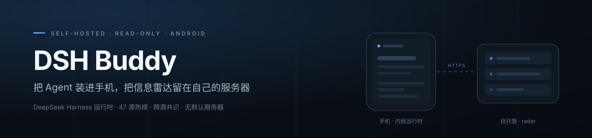
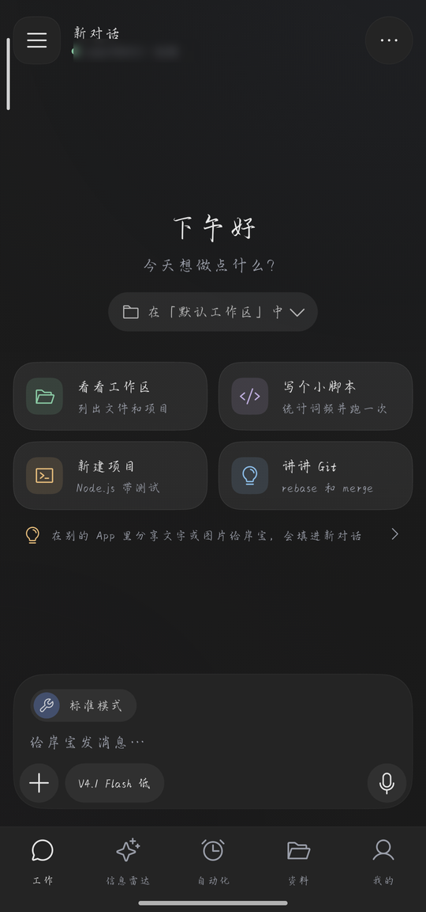
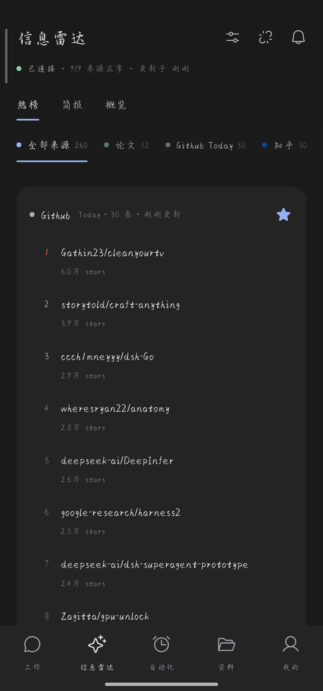
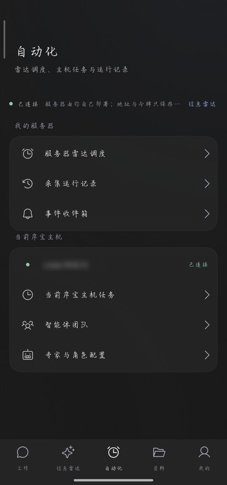
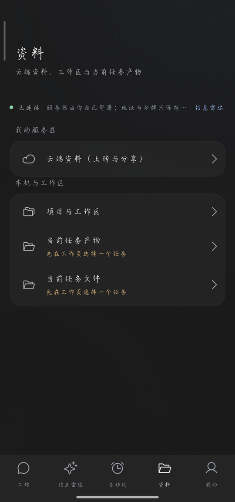
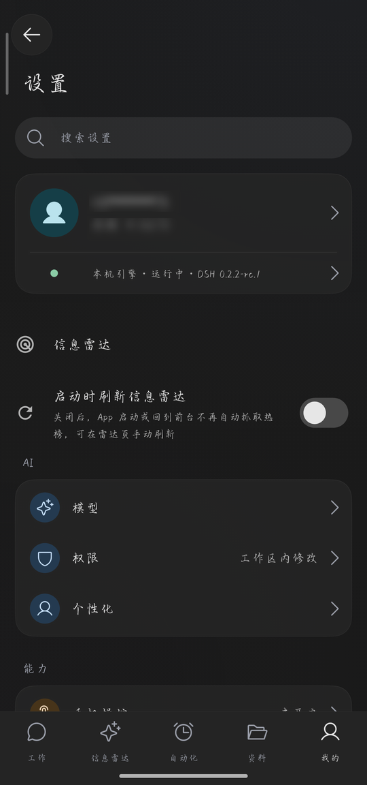
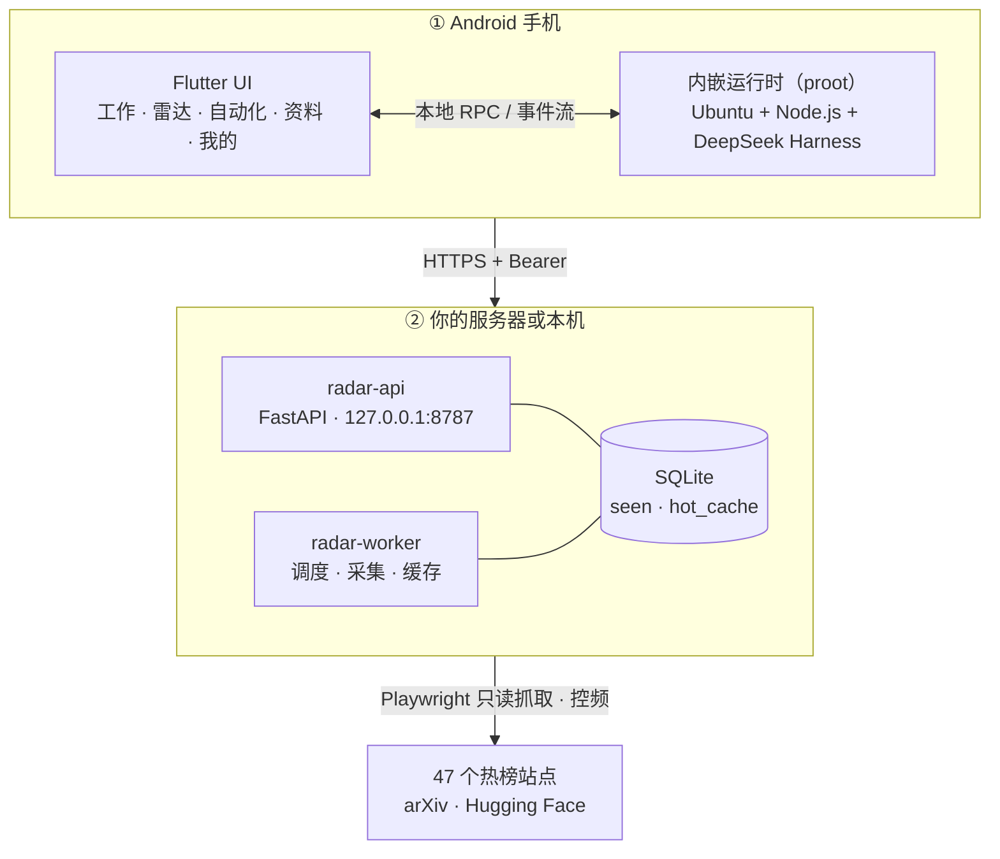
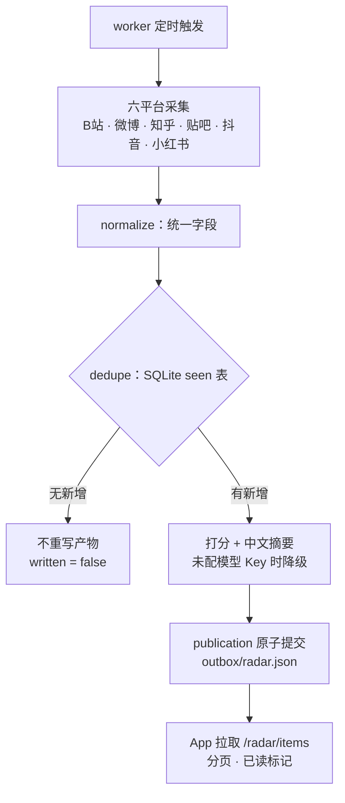
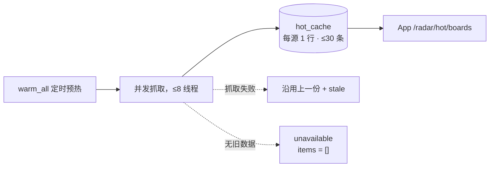

<p align="center">
  
</p>

<p align="center">
  <a href="https://github.com/XXTZ-fia/dsh-buddy/actions/workflows/backend.yml"></a>
  
  
  
  
</p>

## 这是什么

DSH Buddy 是一个安卓客户端。APK 里打包了一份完整的 Ubuntu + Node.js + DeepSeek Harness 运行时，用 proot 直接在手机上跑起来，会话、工作区、工具调用都发生在本机，不经过任何中转服务器。

另外还有一个 Python 写的雷达后端，部署在你自己的机器上。它抓 47 个站点的热榜，把六个平台的更新去重、摘要成简报，再把「同一件事被几家同时报道」的情况排出来。App 连的就是这个后端，地址和令牌都由你填。

两个部分可以分开用。只要热榜，可以只部署后端，用手机连过去；只要远程会话，可以不碰雷达。

## 界面

<table>
  <tr>
    <td align="center" width="20%"><br><sub><b>工作</b></sub></td>
    <td align="center" width="20%"><br><sub><b>信息雷达</b></sub></td>
    <td align="center" width="20%"><br><sub><b>自动化</b></sub></td>
    <td align="center" width="20%"><br><sub><b>资料</b></sub></td>
    <td align="center" width="20%"><br><sub><b>我的</b></sub></td>
  </tr>
</table>

工作页是会话和任务；信息雷达下分热榜、简报、概览三个页签，另有一栏论文；自动化放雷达调度和主机任务；资料管产物和工作区文件；我的负责连接、模型、外观和账号。

截图来自真机，状态栏已裁掉，主机名和账号信息做了模糊处理。

## 雷达做什么

**热榜** 47 个来源一次并发取回，服务端每 5 分钟预热一轮，每源最多 30 条，按国内、国际、财经、科技、体育分栏。来源目录和抓取器一一对应，只加目录不写抓取器会被测试拦下来。

**简报** 六个平台（B站、微博、知乎、贴吧、抖音、小红书）走同一套流程：统一字段、去重、按兴趣词打分，每轮最多留 5 条，配了模型 Key 才有中文摘要。App 每页 20 条，点开即标已读。

**概览** 同一件事被几个站同时放上热榜，才会出现在这里，按共同报道数排序。没配模型 Key 时用规则聚类。

**论文** Hugging Face Daily 和 arXiv，按兴趣词排序，标题和摘要中文化。

抓不到就是抓不到。单个源失败标 `stale`，沿用上一份数据；连旧数据都没有标 `unavailable`，列表为空。界面上不用假条目填空。这条规则是有代价的：Freebuf 全站 405、酷安要过滑块、腾讯视频的接口返回空对象，这几个源我直接删了，而不是留着让人勾了却永远看不到内容。

## 装起来

需要准备的东西：

- 跑雷达：Python 3.11 以上的 Linux，能装 Chromium
- 部署：Ubuntu 或 Debian、systemd、root，一个域名和证书（22.04 要另外装 3.11）
- 构建运行时：x86_64 Linux，WSL2 也行，留 3 GB 磁盘
- 构建 App：Flutter 3.47+、JDK 17、Android SDK
- 手机：arm64，Android 8.0 以上，建议 6 GB 内存

### 1. 先离线跑一遍

```bash
git clone https://github.com/XXTZ-fia/dsh-buddy.git
cd dsh-buddy/radar
python -m venv .venv && . .venv/bin/activate      # Windows: .venv\Scripts\activate
pip install -e ".[dev]"
radar run-once --dry-run
```

`fixtures/` 里有六个平台的样本，`--dry-run` 只读它们，不联网也不碰生产库，跑几次都不会重复入库。要抓真实站点就去掉 `--dry-run`，先 `playwright install chromium`；小红书、知乎、X 还得扫码登录一次，登录态存在 `browser_profiles/`。

### 2. 部署到服务器

```bash
sudo bash radar/scripts/install-server.sh
sudo grep RADAR_BEARER_TOKEN /etc/personal-assistant/radar.env   # 手机端要粘的令牌
```

脚本会建一个 `radar` 系统用户，装到 `/opt/personal-assistant`，生成 64 字符随机令牌，装好 Chromium，再注册 `radar-api` 和 `radar-worker` 两个 systemd 服务。HTTPS 交给 Caddy：

```bash
sudo cp radar/scripts/Caddyfile.example /etc/caddy/Caddyfile
sudo sed -i 's/radar.example.com/你的域名/' /etc/caddy/Caddyfile
sudo systemctl reload caddy
```

```bash
curl https://你的域名/identity -H "Authorization: Bearer <token>"
# {"id":"admin","admin":true,...}
```

返回这个 JSON 就算通了。

### 3. 构建 App

运行时约 200 MB，不在 git 里，得先在 x86_64 Linux 上构建：

```bash
runtime/build-runtime.sh arm64-v8a      # 产出 runtime/out/arm64-v8a/{assets,jniLibs}
```

```bash
cd app
flutter pub get

# 把自己的地址编进去，省得每台设备手填
flutter build apk --release --flavor arm64 \
  --dart-define=RADAR_SERVER_HOST=radar.example.com \
  --dart-define=RELAY_SERVER_HOST=relay.example.com

adb install -r build/app/outputs/flutter-apk/app-arm64-release.apk
```

Windows 上可以直接跑脚本，它会顺带做完分析和测试：

```powershell
powershell -File tool/build-android.ps1 -RadarServerHost radar.example.com
```

请用 release 包。同一台机器上实测，冷启动从 debug 的 1.87 秒降到 release 的 0.43 秒，APK 从 295 MB 降到 207 MB。

不想自己构建的话，[Releases](https://github.com/XXTZ-fia/dsh-buddy/releases) 里有一份预构建包。那是调试证书签的，只适合侧载试用，上架要用自己的签名。

### 4. 连上

打开 App，进信息雷达，填地址、粘令牌。远程会话在「我的 → 连接」里配 SSH 主机或中继账号。

已经有主机在跑的话，前三步都可以跳过。

## 为什么这么设计



App 只做界面和编排，不抓任何站点；雷达只负责采集、去重、摘要和接口，不知道自己被谁调用。两边只通过 HTTP + JSON 通信，所以改雷达和改 App 是两件能分别验证的事。手机连远程主机（SSH 或中继）是可选的第三条路，走 `packages/dsh_remote`。

当初的几条选择，现在还在用：

**采集用 Playwright 的持久化 profile。** 各家的签名参数（`x-s`、`X-Bogus`、WBI）改一次就要跟着改，自研等于给自己养一个长期维护项。用真浏览器，签名、指纹、登录态一次解决。

**App 主动拉，不做推送。** 国内 Android 没有 FCM，iOS 后台不给长连接，WorkManager 最短也是 15 分钟。简报一天一两次，不值得为实时性再搭一套推送。

**去重放在脚本层。** 热榜变化很小，SQLite 主键比让模型判断更确定，也不烧 token。没有新增就不重写产物，App 看文件时间就知道没事发生。

**一个仓库装两端。** 改接口字段得两边一起改，拆成两个仓库反而容易漏。

两条链路的细节：





## 目录

```
code/
├── app/                     Flutter 客户端（Android）
│   ├── lib/ui/              界面：chat / radar / shell / theme / common
│   ├── lib/state/           Riverpod 状态
│   ├── lib/l10n/            国际化：parts/*.arb → gen/
│   └── test/                widget 与 golden 测试
├── packages/
│   ├── dsh_client/          DSH 的 RPC / 事件客户端 + radar_bridge
│   └── dsh_remote/          远程中继客户端与主机连接
├── runtime/                 运行时构建与补丁层（Ubuntu + Node + DSH）
├── radar/                   雷达后端
│   ├── src/radar/hot/       热榜：catalog 源目录、providers 抓取器、service 缓存
│   ├── src/radar/papers/    论文流：HF Daily + arXiv、打分、30 分钟缓存
│   ├── src/radar/sources/   六平台简报采集器
│   └── scripts/             install-server.sh、Caddyfile、backup.py
├── tool/                    打包、图标、i18n 合并与校验
├── docs/PROJECT.md          契约、红线、部署与验收
└── AGENTS.md                硬约束与命令速查（动手前先读）
```

界面在 `app/lib/ui`，状态在 `app/lib/state`，抓取和接口在 `radar/src/radar`。

## 配置

服务端只有两个环境变量是常用的，写在 `/etc/personal-assistant/radar.env`：

| 变量 | 必填 | 说明 |
|---|---|---|
| `RADAR_BEARER_TOKEN` | 是 | 访问令牌，至少 32 字符；安装脚本会自动生成 |
| `RADAR_MODEL_API_KEY` | 否 | 摘要和翻译用的模型 Key（OpenAI 兼容）。不配也能跑，摘要退化成原文片段 |
| `RADAR_ZHIHU_COOKIE` | 否 | 机房 IP 下调知乎热榜用 |

`config.yaml` 管兴趣词和限速：单源每轮 20 条、快照 50 条、每轮简报 5 条、请求间隔 600 ms 加 250 ms 抖动、失败按 5/10/20/30 分钟退避。模板在 [`radar/config.example.yaml`](radar/config.example.yaml)，不含任何凭证。

改完 `radar/` 的代码记得重装包，服务加载的是 venv 里的副本，直接覆盖 `/opt/personal-assistant/radar/src` 不会生效。这个坑我踩过一次，对着一份没生效的代码查了半天。

App 端三个构建参数：

| 键 | 不传时 | 说明 |
|---|---|---|
| `RADAR_SERVER_HOST` | 空 | 预填雷达地址；为空时连接卡片要用户自己填 |
| `RADAR_SERVER_IP` | 空 | 域名对应的 A 记录；填了之后粘裸 IP 会自动归一到域名 |
| `RELAY_SERVER_HOST` | 官方中继 | 自建中继时用 |

## 想改点什么

### 加一个热榜来源

三处都要动：`catalog.py` 加一行，`providers/` 加一个抓取函数并注册，`tests/test_hot.py` 的数量断言改成新的总数。只加目录不写抓取器，`test_catalog_matches_newsnow_visible_sources` 会直接报错。

```python
# radar/src/radar/hot/providers/china.py
from radar.hot.fetch import get_json
from radar.hot.providers.common import Item, heat, item, keep, text

def example(limit: int) -> list[Item]:
    data = get_json("https://example.com/api/hot")
    out = [
        item(
            text(entry, "word"),
            text(entry, "link"),
            heat(text(entry, "score")),
        )
        for entry in data["list"]
    ]
    return keep(out, limit)      # 缺标题或链接的条目在这里丢掉，空榜单抛 FetchError
```

### 改接口

同时改 `radar/src/radar/*/api.py` 和 `app/lib/state/` 里的调用方，两边都跑一遍测试。契约写在 `docs/PROJECT.md` 第 4 节。

### 改界面

先看 `app/lib/ui/radar/radar_management.dart` 和 `app/lib/ui/chat/run_settings_sheet.dart`，这两处是当前的写法范式。颜色用 `DshColors`，圆角用 `AppShape`，图标用 `AppIcons`，别硬编码。改完跑 `flutter test test/radar`，确认金图差异只来自这次改动。

### 改文案

只动 `app/lib/l10n/parts/*_{zh,en}.arb`，然后 `python tool/l10n_merge.py`。中英少一个 key 会直接报错。

## 常见问题

**没有服务器，能只用 App 看热榜吗？**

不能。雷达必须有后端，而这个项目不提供默认服务器，这本身就是设计的一部分。最低成本是一台小 VPS，或者局域网里一台常开的旧电脑。

**必须配模型 Key 吗？**

不必。不配的时候简报摘要取原文片段，概览走规则聚类，功能都在。配了才有 AI 摘要和一句解读。

**知乎、小红书、X 为什么老是显示未启用？**

这三个要登录态。在跑采集的那台机器上执行 `radar login --platform <id>` 扫码一次，登录态存在 `browser_profiles/`，不入库。机房 IP 下知乎还要额外配 `RADAR_ZHIHU_COOKIE`。

**仓库里为什么没有 APK 和运行时？**

运行时 200 MB，放进来不现实；APK 分发又受 AGPL 约束，对外发就得能提供源码。所以按上面第 3 步自己构建。少了 `runtime/out/`，APK 打得出来，但装上去起不来。

**中继服务端在哪？**

不在这个仓库。`packages/dsh_remote` 只是客户端，自建中继需要另外的 `ds-harness-remote` 服务端。不想折腾就用官方中继，或者直接走 SSH。

**这样抓会不会被封号？**

只读、控频、退避，但仍然属于自动化访问。别用主账号，别加并发，某个平台即使低频也被风控的话，正确做法是停掉这个源，而不是想办法绕过去。

## 已知问题

- 全量 `flutter test` 不是全绿，Windows 专属用例、原生桩缺失、过期金图各有原因，分类写在 [AGENTS.md](AGENTS.md) 第 6 节
- 金图依赖 `tool/test-fonts/`（55 MB），不入库，缺了 golden 用例会失败
- `tool/build-android.ps1` 只能在 Windows 上用
- 只有 arm64 Android，没有 iOS 版本
- X、知乎、小红书经常是「本轮未启用」，热榜和简报会如实标注

## 开发

```bash
# 后端
cd radar
pip install -e ".[dev]"
pytest -q                      # 132 passed
ruff check . && ruff format --check .
mypy src/                      # strict

# App
cd app
dart analyze
flutter test test/radar
```

产物可以用 `radar verify-outbox --file <radar.json>` 校验，`generated_at` 超过 24 小时会判失败。

接手开发前建议先读 [AGENTS.md](AGENTS.md)，硬约束和已知基线都在里面；架构和红线在 [docs/PROJECT.md](docs/PROJECT.md)。

## 安全

采集只读，不发帖、不评论、不点赞、不关注、不私信，也不改任何资料。请求按固定间隔加抖动，撞到风控码就退避。

雷达只监听 `127.0.0.1`，公网入口由你自己的反代终结 TLS。管理员令牌只从环境变量读，不落库；设备令牌只存 SHA-256，可以单独撤销。Cookie 只发给目标平台，任何图床、CDN、统计和模型请求都不带。

采集来的内容只进你自己的 SQLite。只有你配了模型 Key 时，摘要文本才会发到你指定的模型端点。

## 许可

AGPL-3.0，见 [LICENSE](LICENSE)。包含基于 [dsh-Go](https://github.com/ccch1mneyyy/dsh-Go) 修改的客户端代码，以及 vendored 的 `runtime/bridge/`、`runtime/media/`，各自保留 LICENSE。

对外分发 APK（上架、放下载链接都算）需要按 AGPL-3.0 提供对应源码。品牌和吉祥物素材不在授权范围内，见 [ASSETS.md](ASSETS.md)；第三方组件见 [THIRD_PARTY_NOTICES.md](THIRD_PARTY_NOTICES.md)。

本项目面向个人学习自用。请自行遵守目标站点的服务条款和 robots 约定，不要用于商业采集、批量分发或绕过访问控制。使用后果自负。

---

## English

DSH Buddy is an Android client with a full DeepSeek Harness runtime baked into the APK: Ubuntu, Node.js and DSH run on the phone through proot, so sessions, workspaces and tool calls never leave the device.

It pairs with a self-hosted Python radar that collects 47 hot lists, dedupes six platforms into a daily brief, and ranks cross-source consensus. There is no default server; you deploy it and point the app at it.

- Read-only by design: no posting, liking, following or profile changes, with fixed rate limits and backoff.
- Honest failures: a broken source reports `stale` or `unavailable` instead of placeholder items.
- Runtime assets (~200 MB) are not in git. Build them on x86_64 Linux with `runtime/build-runtime.sh arm64-v8a`.
- AGPL-3.0. Redistributing the APK requires publishing the corresponding source; brand assets are excluded.

Setup, contracts and red lines live in [docs/PROJECT.md](docs/PROJECT.md); contributor constraints in [AGENTS.md](AGENTS.md).
